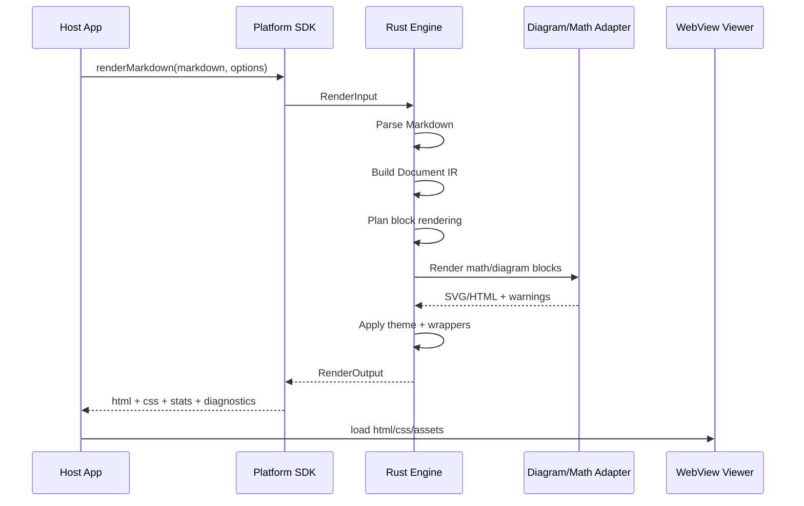
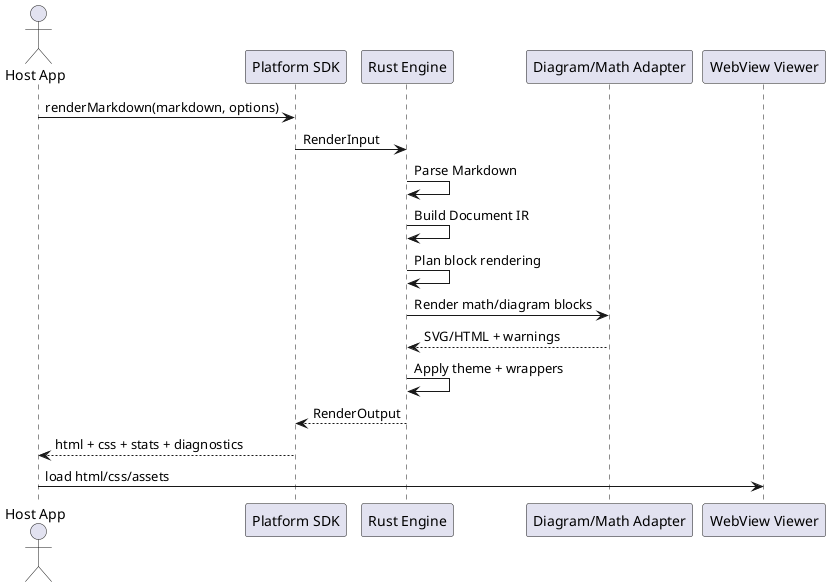

# Oriha Design Notes

Date: 2026-04-30
Status: design direction

## Context

This project targets a Markdown preview experience for mobile and desktop apps.
The expected input is not just plain Markdown, but Markdown plus common authoring
extensions:

- CommonMark / GFM
- fenced callouts
- code blocks
- tables
- LaTeX-style math
- Mermaid diagrams
- PlantUML diagrams

The current practical problem is not only feature support. LaTeX, Mermaid, and
PlantUML are often rendered by separate engines, and their output does not
naturally share spacing, typography, color, error display, mobile overflow
behavior, or analytics.

The long-term opportunity is to treat Markdown as a structured intermediate
language between humans, AI systems, and applications. A good engine should make
Markdown easy to render, inspect, analyze, and embed consistently across mobile
and desktop products.

## Product Direction

Build a portable Markdown document engine, not only a Markdown parser.

The engine should accept Markdown and return a normalized render result:

- HTML fragment
- optional CSS
- embedded or referenced SVG assets
- render statistics
- diagnostics
- source mapping between rendered blocks and Markdown ranges

The app-specific layer should stay thin. Swift, Kotlin, React Native, macOS, and
Windows apps should consume the same engine contract instead of reimplementing
Markdown behavior per platform.

## Core Principle

Separate the engine from the viewer.

- Engine: parse Markdown, build a document IR, render HTML/CSS/SVG, collect stats,
  and return diagnostics.
- Viewer: display the output in WebView, WKWebView, Android WebView, desktop
  WebView, or browser runtime.

This keeps the visual system, block semantics, and analytics consistent while
still allowing each host app to choose its native shell.

## Non-Goals

These are intentionally outside the first implementation scope:

- Reimplement all of Mermaid in Rust.
- Reimplement all of PlantUML in Rust.
- Reimplement a full LaTeX engine in Rust.
- Render complex documents as fully native SwiftUI / Jetpack Compose trees.
- Make Tailwind CSS a runtime dependency.

The initial engine should normalize and theme third-party diagram/math output
instead of replacing every specialized renderer.

## Architecture

```text
Markdown source
  -> Block detector
  -> Block parser
  -> Inline parser / content adapters
  -> Canonical Document IR
  -> Canonical HTML renderer
  -> Theme engine
  -> HTML / CSS / SVG / stats / diagnostics
```

Block parsers and content adapters may be replaced incrementally. Final HTML
structure should remain owned by the canonical renderer so different parser or
adapter implementations cannot leak incompatible wrappers, classes, spacing, or
analytics behavior into host apps.

Recommended crate layout:

```text
oriha/
  crates/
    core          # parse -> IR -> render plan -> render result
    theme         # theme tokens and CSS generation
    adapters      # math / Mermaid / PlantUML provider interfaces
    uniffi        # Swift/Kotlin boundary for native apps
    uniffi-bindgen # workspace-local UniFFI binding generator
    wasm          # wasm-bindgen boundary for web runtimes
    cli           # local render / inspect / diff commands
  packages/
    react-native  # React Native wrapper
    web-viewer    # WebView runtime assets
    swift         # Swift Package / XCFramework distribution
    kotlin        # Android AAR / Maven distribution
    node          # optional npm / wasm package
```

## Document IR

The document IR is the durable internal asset. It should represent document
structure independently from the final HTML shape.

Example block kinds:

- `Document`
- `Heading`
- `Paragraph`
- `List`
- `Table`
- `CodeBlock`
- `Callout`
- `MathInline`
- `MathBlock`
- `Diagram`
- `Quote`
- `ThematicBreak`
- `HtmlBlock`
- `LegacyMarkdown`
- `ForeignHtml`

The IR should preserve enough metadata for:

- stable block IDs
- source ranges
- heading hierarchy
- code language
- callout kind
- diagram kind
- diagnostics
- analytics stats

Parser/adaptor output should converge on this IR. External HTML, when unavoidable,
should be isolated as `ForeignHtml` and wrapped, sanitized, themed, and tracked by
the engine before it reaches a viewer.

## Render Modes

The engine should support at least two output modes.

`styledHtml`

Returns HTML plus engine-owned CSS. This is the default for product embedding.
The host app gets a complete, consistent preview.

`semanticHtml`

Returns HTML with stable classes, IDs, and data attributes, but without full CSS.
This allows a host product to provide its own external stylesheet while still
using the engine's parsing, IR, diagnostics, and stats.

Optional later modes:

- `htmlFragment`: minimal fragment for custom containers
- `staticDocument`: standalone HTML document for export
- `inspectJson`: IR and stats for debugging or analytics pipelines

## Render API

The public API should be broad enough to avoid chatty FFI calls. Use a single
render request and a single render result at the platform boundary.

```ts
type RenderInput = {
  markdown: string;
  theme: string | ThemeSpec;
  mode: "styledHtml" | "semanticHtml";
  features: {
    gfm: boolean;
    callouts: boolean;
    math: boolean;
    mermaid: boolean;
    plantuml: boolean;
  };
  viewport?: {
    width: number;
    scale: number;
  };
};

type RenderOutput = {
  html: string;
  css?: string;
  stats: RenderStats;
  diagnostics: RenderDiagnostic[];
  assets: RenderAsset[];
};
```

For Swift and Kotlin, prefer a small number of coarse calls. `render(input_json)`
returning `output_json` is a reasonable first FFI shape even if the Rust internals
use richer typed models.

## Theme Engine

The theme engine should use design tokens rather than Tailwind classes.

Example token groups:

- color: text, muted text, background, surface, border, accent, warning, danger
- typography: body font, mono font, math font, heading scale, line height
- spacing: block gap, list indent, table cell padding, diagram margin
- shape: border radius, callout stripe width, table border style
- diagram: node fill, edge stroke, label color, cluster background
- code: background, text color, token colors, gutter color

Generated CSS should prefer CSS custom properties:

```css
:root {
  --oriha-color-text: #17202a;
  --oriha-color-muted: #5b6773;
  --oriha-color-surface: #ffffff;
  --oriha-font-body: ui-sans-serif;
  --oriha-font-mono: ui-monospace;
}
```

The same tokens should be used to normalize HTML blocks, callouts, code blocks,
tables, math wrappers, and diagram wrappers.

## Diagram And Math Strategy

Mermaid, PlantUML, and LaTeX should be adapter-backed.

The first goal is not full native replacement. The first goal is a unified render
contract around specialized engines.

Adapter responsibilities:

- receive normalized source from the IR
- call the selected renderer
- return SVG or HTML plus warnings
- expose cache keys
- expose renderer version when available
- avoid leaking renderer-specific error shapes into the final app API

Engine responsibilities after adapter output:

- wrap output in consistent HTML
- normalize spacing
- normalize mobile overflow behavior
- normalize captions and labels
- normalize diagnostics
- post-process SVG when feasible
- collect stats
- apply theme tokens where feasible

SVG post-processing should be conservative. Good first targets:

- `viewBox`
- responsive sizing
- font family
- text color
- background removal
- stroke/fill token substitution where safe
- stable root class names

## Sequence

The following diagrams describe the same high-level flow. They are embedded in
both Mermaid and PlantUML because Markdown preview support differs across tools.
If a previewer cannot render either diagram, the text flow above remains the
source of truth.





## Platform Integration

Mobile:

- React Native calls Swift/Kotlin native modules.
- Swift/Kotlin call the Rust engine through generated UniFFI bindings.
- Rendered HTML/CSS/SVG is loaded into a WebView.
- Viewer runtime handles link taps, source block taps, zoom, copy, and theme
  switching.

Desktop:

- macOS can use the same Swift package or a Tauri/Wry shell.
- Windows can use a future dedicated binding, .NET binding, or a Tauri/Wry shell.
- A CLI should exist from the beginning for local rendering, debugging, and
  golden tests.

Web:

- A wasm target can expose the same render contract.
- Mermaid or math adapters may differ by target, but output should still pass
  through the same wrapper and theme layer.

## Stats

Render stats should be first-class output, not a side effect.

Useful initial metrics:

- total block count
- heading count by level
- callout count by kind
- code block count by language
- table count
- math inline count
- math block count
- Mermaid diagram count by type when detectable
- PlantUML diagram count
- render warnings by category
- unsupported block count

Stats should be designed with privacy in mind. Prefer structural counts over
capturing raw document content.

## Diagnostics

Diagnostics should be stable across platforms.

Recommended fields:

```ts
type RenderDiagnostic = {
  severity: "info" | "warning" | "error";
  code: string;
  message: string;
  sourceRange?: {
    startLine: number;
    startColumn: number;
    endLine: number;
    endColumn: number;
  };
  blockId?: string;
  engine?: "core" | "math" | "mermaid" | "plantuml";
};
```

Do not expose raw third-party renderer errors as the primary contract. Map them
to stable engine diagnostics and include original details only when useful for
debugging.

## Security And Sandboxing

The engine must treat Markdown as untrusted input unless the host explicitly
opts into a trusted mode.

Initial rules:

- sanitize raw HTML by default
- block dangerous URL schemes by default
- restrict PlantUML network access through explicit adapter configuration
- set timeout and size limits for diagram/math rendering
- cap rendered block count and source size
- make external fetches opt-in
- expose diagnostics when content is skipped or sanitized

## MVP Scope

The first useful version should include:

1. Self-owned block detection for all CommonMark block categories.
2. Typed IR/rendering for headings, fenced code, and callouts.
3. Legacy Markdown fallback through an existing Rust parser for detected but unmigrated blocks.
4. Document IR with stable block IDs and source ranges.
5. Canonical HTML rendering for typed blocks and engine-owned wrappers for fallback output.
6. Theme token system and generated CSS.
7. `styledHtml` and `semanticHtml` modes.
8. Adapter interface for math, Mermaid, and PlantUML.
9. Conservative SVG/HTML wrapper normalization.
10. Render stats and diagnostics from IR rather than HTML scraping.
11. CLI for `render`, `inspect`, and golden fixture checks.
12. React Native proof of concept using WebView.

## Success Criteria

The engine is succeeding when:

- the same Markdown renders consistently on iOS, Android, desktop, and web
- diagram/math blocks look like part of the same document system
- host apps can embed the preview with a small API surface
- analytics can be collected without parsing Markdown again in the app
- render errors are visible and stable
- themes can be changed without rewriting renderers
- future AI workflows can target the IR instead of raw HTML
