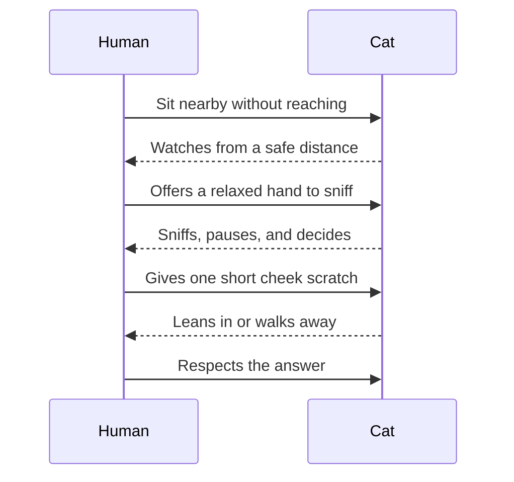

## Field Notes on the Domestic Cat

Photo: [Manja Vitolic on Unsplash](https://unsplash.com/photos/black-and-white-cat-lying-on-brown-bamboo-chair-inside-room-gKXKBY-C-Dk)

:::note Observation brief
Cats are small predators with large opinions. A comfortable cat may look lazy,
but the ears, whiskers, tail, and eyelids are always collecting data from the
room.
:::

The domestic cat lives in a strange overlap between wild instinct and household
routine. It can sleep in a sunbeam for hours, wake instantly when a paper bag
rustles, and then inspect the same chair as if the chair had filed a suspicious
report overnight.

That contradiction is what makes cats useful subjects for a rich Markdown
preview. A cat article can include a photograph, field notes, behavior tables,
sequence diagrams, tasks, and a completely unnecessary equation about cosmic
feline energy. It feels like a real document, but it also has enough odd corners
to exercise typography, spacing, image handling, tables, diagrams, and math.

### Why Cats Watch Before They Move

Cats rarely enter a new situation at full speed. They pause, listen, smell, and
measure the scene. The pause is not indecision; it is risk management. Their
eyes are tuned for motion, their ears can rotate toward tiny sounds, and their
whiskers help them judge whether a narrow gap is worth attempting.

In a home, those senses are aimed at very ordinary events. A closing laptop, a
cup placed on a table, or the quiet opening of a snack drawer can become a
signal. The cat builds a map of repeated patterns: when people wake up, where
warmth appears, which chair is safest, and which human forgets to guard the
laundry basket.

:::tip Reading the room
If a cat approaches slowly, let the cat finish the approach. Reaching too early
turns a conversation into a negotiation, and cats are famously strict
negotiators.
:::

### A Small Behavior Table

| Signal | Likely meaning | Human response |
| :-- | :-- | :-- |
| Slow blink | Relaxed trust | Blink slowly back and stay still |
| Tail tip twitch | Interested, but undecided | Give the cat more time |
| Ears turned sideways | Tension or irritation | Stop touching and create space |
| Cheek rub | Familiar scent marking | Accept the compliment politely |
| Sudden zoom across the room | Stored energy escaping | Move fragile cups out of orbit |

### The Nap Is Part of the System

A cat's long sleep schedule is not just a lifestyle choice. Cats evolved around
short bursts of intense activity: stalk, pounce, eat, groom, recover. Even when
the prey is now a felt mouse under the sofa, the operating system remains
similar. Rest is the battery charger for sudden precision.

This is why the sleeping cat should not be dismissed as inactive. It is running
a background process. The ears may still track the room. The nose may still
notice dinner. One eye may open just enough to confirm that nothing important is
happening unless the sound resembles a treat bag.

> A sleeping cat is not offline. It is simply in low-power surveillance mode.

### Becoming Friends With a Cat

The fastest way to befriend a cat is often to become less interesting. Sit low,
avoid staring, offer a hand for scent, and let the cat decide whether the
meeting continues. The goal is not to win attention. The goal is to become a
predictable part of the room.

The important step is the last one. When a cat leaves, the interaction is not a
failure. It is data. The cat has learned that leaving is allowed, which makes
returning safer.

### Cosmic Cat Theory

Every cat owner eventually observes behavior that cannot be explained by normal
physics. A cat may ignore an expensive toy but worship a cardboard corner. It
may choose the exact keyboard shortcut that closes a document. It may sit in a
box that is clearly too small and still make the geometry work.

For paywall purposes, we can express this with a deeply unserious model:

$$
C_{cosmic} = \frac{purr^2 + curiosity}{nap + gravity}
$$

In this equation, $purr$ increases trust, $curiosity$ increases chaos, and
$nap$ prevents the entire universe from becoming a hallway sprint. The constant
$gravity$ is optional, because cats appear to negotiate with it on a case-by-case
basis.

### Practical Notes for Humans

- [x] Let the cat initiate close contact.
- [x] Watch the tail before assuming consent.
- [x] Keep food, play, and rest areas predictable.
- [ ] Understand why the best bed is still the cardboard box.

The final lesson is simple: a cat is not a tiny person, and not a tiny dog. It
is a compact roommate with predator hardware, ritual preferences, and a private
calendar full of invisible appointments.
